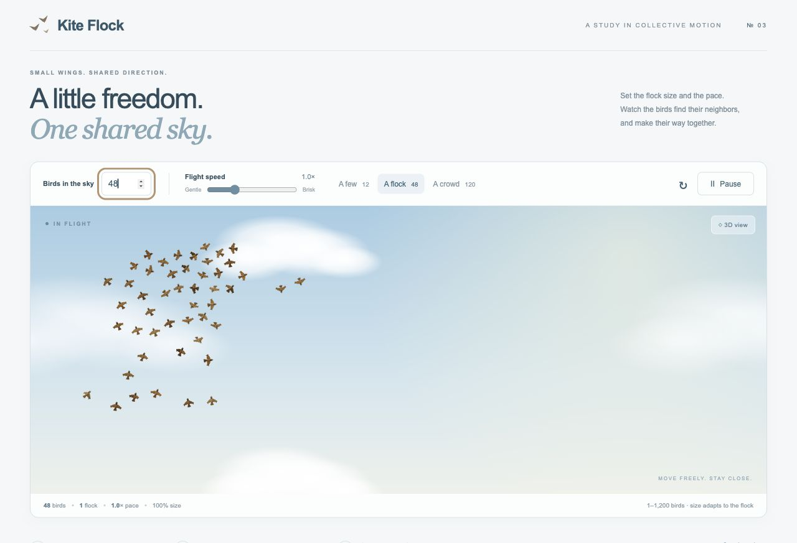

# Kite Flock

A bird-flocking playground inside a finite sky scene, with a fixed perspective camera, shaded rounded bodies, articulated wings, and gentle banking. The view button switches between **3D view** and **Original 2D** during the same flight. Nearest-neighbor flocking and size rules use `c49cd89` as their baseline, with predictive slowing and turning added near birds and boundaries. The 3D view uses a locally bundled Three.js renderer. Start with 12 sparrow-like birds, type a count or use the number arrows to change it immediately, or choose a 12 / 48 / 120 preset. Existing birds keep their positions when the population changes. The **Flight speed** slider adjusts the pace from **0.4× to 2.5×**, with gradual acceleration and deceleration. **Pause / Resume** eases the animation to a stop and back into flight; the circular arrow starts a fresh arrangement at the same count and selected pace.



## Run

Requires Node.js 18 or newer (developed with the installed Node.js 21.6.2). No package installation is necessary.

```sh
cd "/Users/danilkum/Documents/ChatGPT/Fun games"
npm start
```

Open **http://127.0.0.1:4173** on the laptop. Stop the server with Ctrl+C in its terminal. Set `PORT` to choose another port.

### Open on a phone on the same Wi-Fi

The server now binds to `0.0.0.0`, accepting connections from the local network. At startup it prints **Same Wi-Fi / LAN** addresses. Open the address matching the laptop's Wi-Fi adapter on the phone, for example `http://192.168.x.x:4173/`. Use `http://`, and use the laptop's IP rather than `localhost` on the phone. Keep the laptop awake and the server running.

If localhost works but the phone cannot connect, check that both devices are on the same non-guest Wi-Fi, Node is allowed to receive incoming connections in the laptop's firewall, and the network or VPN permits connections between local devices. The server serves only the allowlisted public app assets; it does not expose the repository directory. No router port forwarding is needed for same-Wi-Fi use. To restrict the app to the laptop again, run `HOST=127.0.0.1 npm start`.

## GitHub Pages

The simulation is a static site: all movement runs in the visitor's browser. GitHub Pages does not run `server.mjs`. Styles, scripts, module imports, and the home link use relative paths so the app works at both `/` and `/fun-games/`.

### Current repository setup

The source repository is [Anilkumar011/fun-games](https://github.com/Anilkumar011/fun-games), and it is public. GitHub Pages is configured with GitHub Actions, and the published app is **[https://anilkumar011.github.io/fun-games/](https://anilkumar011.github.io/fun-games/)**. Anyone can open this HTTPS link on a phone or computer; the laptop server does not need to be running.

To configure Pages again or set up a fork:

1. Open the repository's **Settings → Pages → Build and deployment** and select **GitHub Actions** as the source.
2. Open **Actions → Deploy Kite Flock to GitHub Pages → Run workflow**, selecting `main`.
3. Wait for the `deploy` job to succeed. Its environment link is the published website address for that repository.

GitHub Pages supports public repositories on Free and private repositories on eligible paid plans; see [GitHub's Pages documentation](https://docs.github.com/en/pages/getting-started-with-github-pages/using-custom-workflows-with-github-pages). A fork kept private must have an eligible plan before enabling Pages.

The workflow also runs on pushes to `main`. It tests the simulation and hosting paths, builds `dist/`, and uploads only the app modules, vendored Three.js build/license, and `.nojekyll`. If Pages is not enabled yet, tests/build still run and deployment is skipped with a setup notice. The source, tests, local server, README, and preview image are excluded from the deployed website artifact. For a separate repository, include this workflow and its supporting source/test/build files, or upload just the contents of `dist/` using that repository's static Pages setup.

### Preview exactly the static site locally

```sh
npm run preview
```

Open **http://127.0.0.1:4174/fun-games/**. This serves the generated files under a repository subpath and can run alongside the Wi-Fi server on port 4173. Use Ctrl+C to stop it. `npm run build` recreates the generated `dist/` directory, which is ignored by Git.

## Motion rules and limits

- Nearest-neighbor following, local alignment/cohesion/separation, group gathering, placement and density sizing retain the `c49cd89` baseline. A new safety layer changes reactions to predicted encounters and approaching boundaries; paths near those threats intentionally differ from the historical commit.
- The original density scaling uses the full available scene area. There is no extra reduction for a compact formation or circular route. At 1,100 × 470 scene pixels, both 12 and 48 birds remain at 100% size; 1,200 use approximately 36% size, exactly as before.
- Cruise speed remains 42 scene pixels per second at 1.0×, ranging from 16.8 to 105. Detached birds use the original catch-up speed and return to cruise after rejoining. The finite boundary remains. Anticipation predicts straight and turning neighbor paths 1.2 seconds ahead, and arrival at a wall 1.6 seconds ahead. A threatened bird eases its speed, cancels catch-up thrust, and turns with bounded angular acceleration. Boundary threats take priority when needed; a committed turn side prevents indecision at an edge. Emergency contact projection remains for unavoidable crowded starts or sudden resize, but walls no longer instantly reverse a bird’s heading.
- Rendering reads simulation state without modifying positions, headings, scale, or bird order. A fixed camera shows forward travel. Switching to Original 2D draws the original bird shapes while the same simulation continues.
- The WebGL 3D renderer uses a custom sparrow model with a rounded chest/head, cheek/eye/beak detail, layered cambered feathers, a textured feather material, and sun/sky lighting. Three wing segments per side animate the shoulder, elbow and wrist; the tail fans during braking. Eight shared instanced meshes render every population without reducing model size or replacing the birds with low-detail triangles. A Canvas renderer remains available if WebGL cannot initialize. It derives the bank pose from speed and turn rate using the coordinated-turn relationship `tan(bank) = speed × turnRate / gravity`. The rendering gravity is calibrated in scene units for the original animation pace. See [NASA’s explanation of banking and lift](https://www1.grc.nasa.gov/beginners-guide-to-aeronautics/banking-turns/).
- Wing effort increases during catch-up and banked turns, with gliding between flapping bursts. These are visual flight cues layered over the approved flocking; the scene does not solve a full aerodynamic model. The original paths remain in their horizontal plane, while body and wing geometry have actual depth.

The limits are **1–1,200 birds in desktop views** and **1–300 in phone-sized views**, without an additional area-based count cap. Phone-sized means a viewport narrower than 768 pixels, or narrower than 1,000 pixels and shorter than 500 pixels (including landscape phones). When resizing from desktop to a phone-sized view, the first 300 birds are retained and a message explains the change.

As density rises, birds and their clearance distances shrink together to fit the available sky. Lower-count birds retain their full-size wing/body cues; at maximum counts the birds intentionally become small silhouettes. The status bar shows the current scale. Returning to a smaller population eases sizes back up without resetting the surviving birds.

Valid count edits apply immediately. Empty, fractional, or out-of-range edits leave the existing flock flying; leaving the field restores the last active count if the edit is still invalid. Numeric spatial grids keep neighbor lookup and collision work local. Actual frame rates depend on the device; dense flocks can be slower on older phones. Long browser stalls drop excess elapsed time rather than teleporting birds through one another. Motion pauses while the page is hidden and starts paused when the operating system requests reduced motion.

## Verify

```sh
npm test
```

The 17 automated tests cover counts, identity, speed transitions, gathering, clearance, resizing, rendering and hosting. Avoidance tests exercise head-on/crossing/catch-up approaches and all four walls/corners, checking actual displacement, bounded turn/speed changes and clearance without position corrections in those scenarios. Rendering tests check historical sizing, read-only rendering, bank poses and articulated GPU transforms. The hosting test verifies root and repository-subpath deployments, including vendored assets.

The reference fixture is `test/fixtures/c49cd89-flight.json`, generated directly from the historical commit. It contains historical samples for 12, 48 and 300 birds at normal, brisk and gentle paces. Tests use it to preserve size; exact near-threat trajectories are no longer asserted because avoidance is an intentional behavior change. Browser checks cover 3D/Original 2D switching, full-size birds, playback, and console errors.

## Files

- `index.html`, `styles.css`: responsive interface.
- `app.mjs`: animation loop and controls.
- `renderer.mjs`: sky, original 2D view, bank pose and Canvas fallback.
- `renderer-3d.mjs`, `bird-model.mjs`: GPU renderer, sparrow geometry and articulated wing rig.
- `vendor/three.module.min.js`, `vendor/THREE-LICENSE.txt`: pinned Three.js r170 browser build and MIT license.
- `flock.mjs`: simulation engine, independent of the browser.
- `server.mjs`: local static server using Node's standard library.
- `test/flock.test.mjs`, `test/avoidance.test.mjs`: movement and clearance checks using Node's built-in test runner.
- `test/renderer.test.mjs`, `test/fixtures/c49cd89-flight.json`: historical sizing and read-only rendering checks.
- `test/hosting.test.mjs`: generated-site and HTTP checks.
- `scripts/build.mjs`, `scripts/preview.mjs`: static packaging and repository-subpath preview.
- `.github/workflows/pages.yml`: validation and GitHub Pages deployment.

Three.js r170 is vendored from the [official repository](https://github.com/mrdoob/three.js/tree/r170) under its MIT license. No installation or runtime network access is required. The bird geometry and textures are generated locally by this project; no third-party bird artwork is used.
